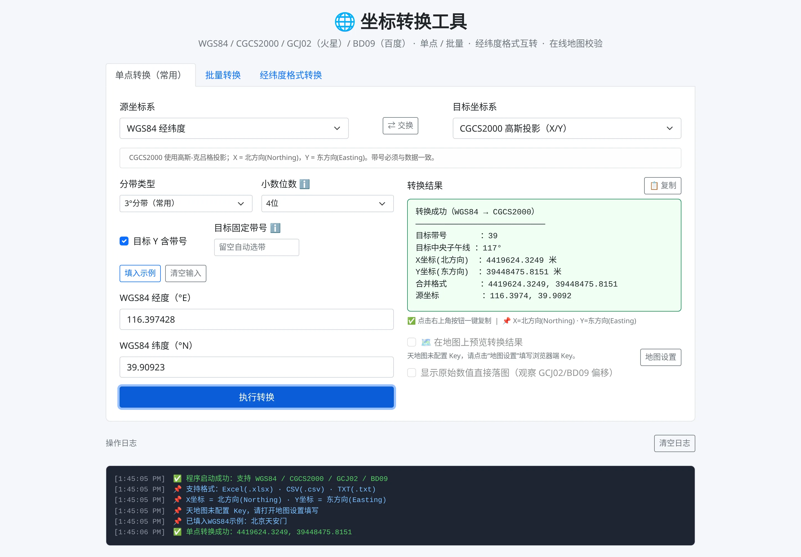
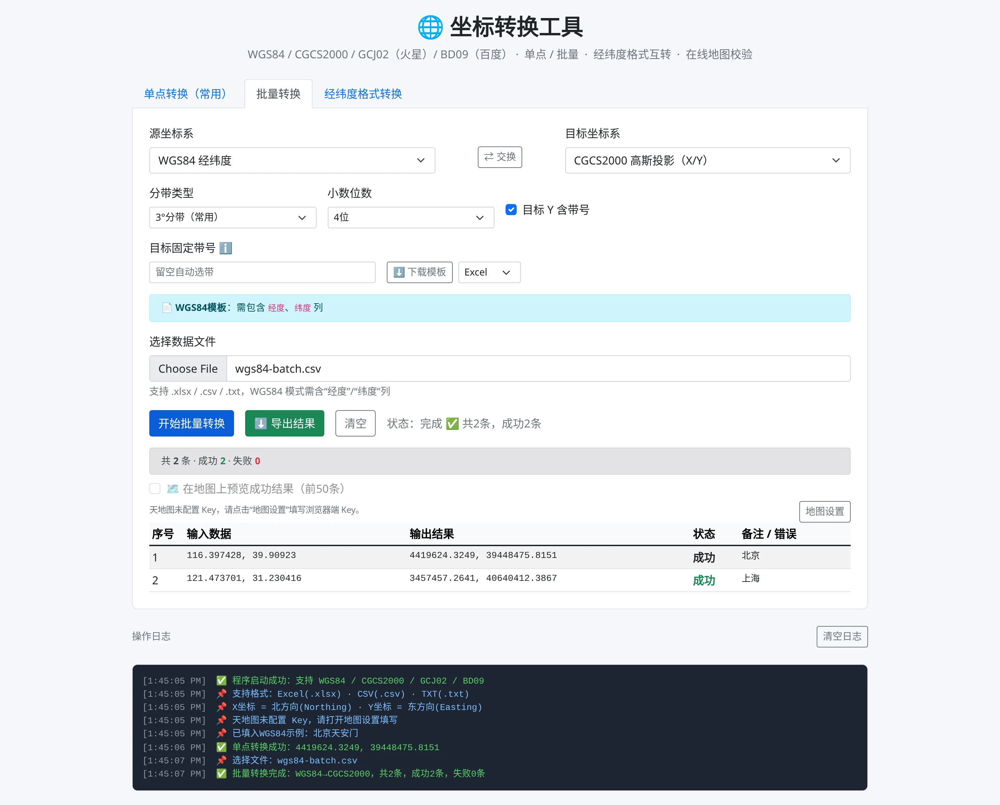
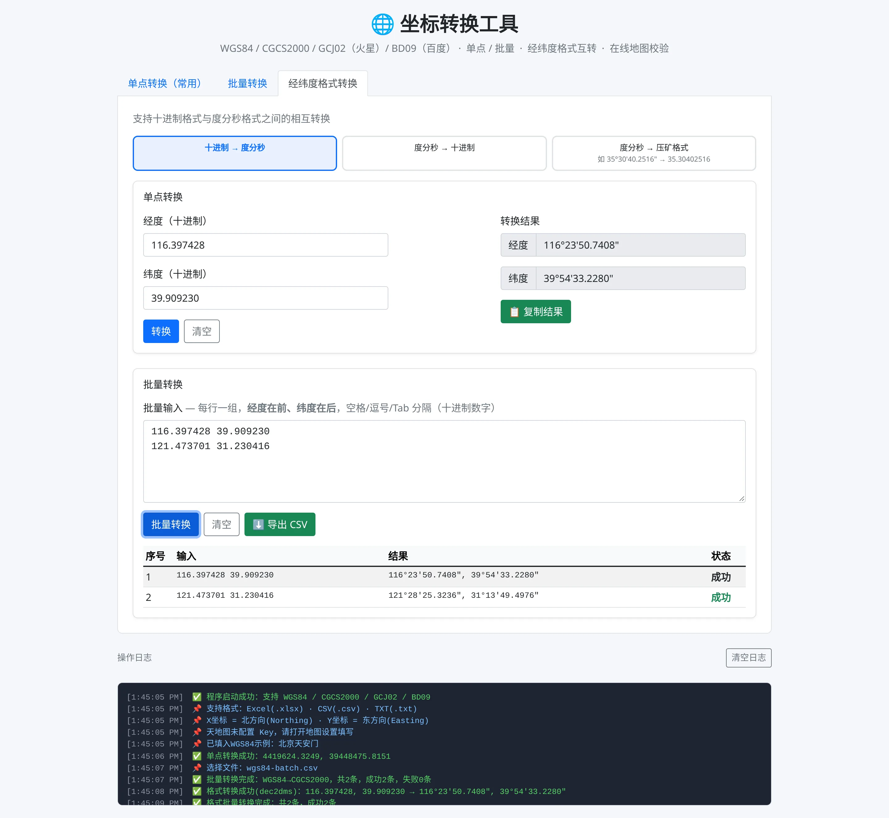
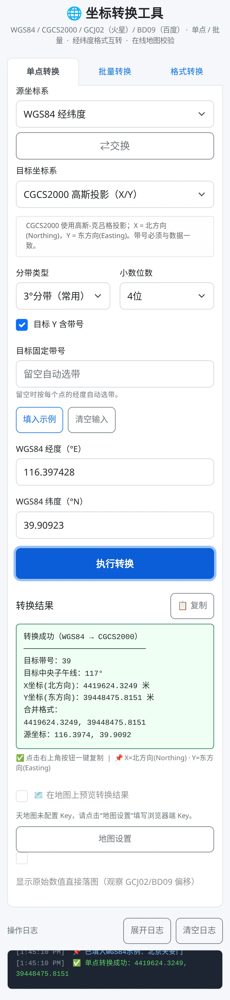
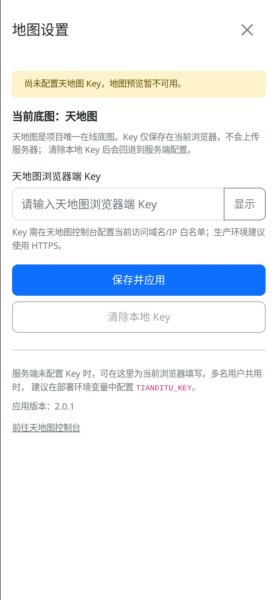

# 🌍 坐标转换工具（WGS84 / CGCS2000 / GCJ02 / BD09）

一个开箱即用的 Web 坐标转换服务，支持 **WGS84、CGCS2000 高斯投影、GCJ02（火星）、BD09（百度）** 任意组合转换，提供：

- 📍 单点坐标转换
- 📦 批量文件转换（xlsx / csv / txt）
- 📥 模板下载与结果导出（保留额外列）
- 🗺️ 可选天地图在线预览，校验原坐标与转换结果
- 🔑 页面内地图设置，支持浏览器端天地图 Key
- 📱 移动端触控优化：sticky 标签、16px 输入、卡片结果表、安全区适配
- 🐳 Docker / 群晖 Container Manager 一键部署（amd64 / arm64 多架构镜像）

> 后续开发、测试和运维请阅读 [技术文档与交接说明](docs/TECHNICAL.md)。
>
> 版本变更请查看 [更新记录](CHANGELOG.md)。

## 界面预览

### 单点转换



### 批量转换



### 经纬度格式转换



### 移动端

<p align="center">
  
</p>

### 地图设置（天地图 Key）

<p align="center">
  
</p>

---

## 🧭 支持的坐标系

| 类型 | 说明 | 输入 / 输出 |
| --- | --- | --- |
| WGS84 | GPS / 国际通用地理坐标 | 经度、纬度 |
| CGCS2000 | 国家 2000 高斯-克吕格投影 | X=北方向，Y=东方向，带号 |
| GCJ02 | 火星坐标（高德/腾讯等国内地图） | 经度、纬度 |
| BD09 | 百度坐标 | 经度、纬度 |

CGCS2000 支持：

- 3° 分带：带号 25~45，含带号 / 不含带号
- 6° 分带：带号 13~23，含带号 / 不含带号
- 源带号必填；目标带号可留空（按每点经度自动选带），也可固定带号统一成果
- 带号前缀与 Y 坐标不一致、Y 范围异常、反算经度偏离中央子午线时直接报错，避免静默输出错误坐标

> GCJ02 / BD09 为公开近似算法，仅适用于中国范围；与官方接口结果可能存在米级差异。WGS84 与 CGCS2000 使用 pyproj / EPSG 权威参数。

---

## 🗺️ 在线地图预览（天地图）

单点转换和批量转换（前 50 条）均可勾选天地图预览：

- 原坐标与转换结果分别落图，用于检查是否落在正确位置
- 单点可额外勾选“显示原始数值直接落图”，直观观察 GCJ02 / BD09 偏移
- 地图默认**不启用**；勾选后坐标才会发送至天地图
- `v2.0.0` 起已移除 OpenStreetMap 和自定义 XYZ 瓦片，只保留天地图

### 天地图 Key

天地图需要浏览器端 Key。可以通过两种方式配置：

1. 环境变量 `TIANDITU_KEY`：所有访问者共用。
2. 页面“地图设置”：保存在当前浏览器 localStorage，只对当前浏览器生效。

优先级：浏览器本地 Key > 服务端 `TIANDITU_KEY`。清除本地 Key 后会回退到服务端 Key。

注意事项：

- 请在天地图控制台配置实际访问域名/IP 的**域名白名单**
- 生产环境建议使用 HTTPS
- Key 只保存在浏览器或环境变量中，不会写入日志
- 未配置 Key 时地图勾选会禁用，可通过“地图设置”填写

### 配置

| `MAP_PROVIDER` | 说明 |
| --- | --- |
| `tianditu` | 天地图（默认） |
| `none` | 关闭在线地图预览 |

```env
# 地图服务：tianditu | none
MAP_PROVIDER=tianditu

# 天地图浏览器端 Key；留空时在页面“地图设置”中填写
TIANDITU_KEY=
```

> 旧版本中的 `MAP_PROVIDER=osm/auto/custom` 已不再支持，会自动回退为天地图。`OSM_TILE_URL`、`MAP_TILE_URL`、`MAP_TILE_ATTRIBUTION`、`MAP_TILE_CRS` 已移除。

### 安全与隐私

- 天地图 Key 为浏览器端 Key，请务必配置域名白名单
- 生产环境建议全站 HTTPS
- CSP 仅放行 `https://*.tianditu.gov.cn`
- 未配置 Key 时页面不会请求天地图瓦片
- Key 不写入日志，浏览器设置仅保存在 localStorage

---

## 🚀 群晖用户快速开始（可视化部署）

> 目标：用户只改 **端口** 和 **版本**，其余保持默认即可。

### 1) 在群晖创建项目

在 DSM 的 **Container Manager → 项目** 中，新建一个项目目录（例如 `docker/wgs84-cgcs2000`）。

把下面内容保存为 `docker-compose.yml`：

```yaml
services:
  coordinate-converter:
    image: ghcr.io/marod1m/wgs84-cgcs2000:latest
    ports:
      - "5000:5000"
    environment:
      # 地图服务：tianditu | none
      MAP_PROVIDER: tianditu
      # 天地图浏览器端 Key；也可以部署后在页面“地图设置”中填写
      TIANDITU_KEY: ${TIANDITU_KEY:-}
    restart: unless-stopped
```

### 2) 只改需要的地方（可选）

- 改端口：把 `5000:5000` 左边改为你想要的端口（如 `12345:5000`）
- 改版本：把 `latest` 改为固定版本（如 `2.0.1`）
- 启用地图：配置 `MAP_PROVIDER=tianditu`；`TIANDITU_KEY` 可填在环境变量，也可部署后在页面“地图设置”中填写

### 3) 点击“下一步/完成”部署

部署成功后在浏览器访问：

- `http://群晖IP:端口`
- 健康检查：`http://群晖IP:端口/healthz`

期望返回：

```json
{"status":"ok","version":"2.0.1"}
```

---

## 💻 Linux / 命令行用户快速开始

### 1) 准备配置

```bash
cp .env.example .env
```

按需修改 `.env`：

```env
APP_PORT=5000
APP_VERSION=latest
MAP_PROVIDER=tianditu
TIANDITU_KEY=
```

### 2) 一键启动

```bash
docker compose up -d
```

### 3) 访问服务

- `http://localhost:5000`
- `http://localhost:5000/healthz`

---

## 🧩 两种 Compose 方案说明

### 方案 A：极简版（默认，推荐默认方案）

文件：`docker-compose.yml`

- 只保留必须项，复制即用
- 只需要关心端口、版本和可选地图配置

### 方案 B：进阶版（安全与可观测增强）

文件：`docker-compose.full.yml`

启用方式：

```bash
docker compose -f docker-compose.full.yml up -d
```

进阶版额外包含：健康检查、只读根文件系统、`tmpfs /tmp`、`no-new-privileges` 等配置。

---

## 🏷️ 版本与镜像标签

Git 标签和镜像标签不是同一种格式：

| Git 标签 | GHCR 镜像标签 |
| --- | --- |
| `v2.0.1` | `2.0.1`、`2.0`、`latest` |
| `v2.0.0` | `2.0.0`，历史固定版本仍可拉取 |

`APP_VERSION` 必须填写镜像标签，不能带 `v` 前缀：

```env
# 正确
APP_VERSION=2.0.1
APP_VERSION=latest

# 错误
APP_VERSION=v2.0.1
```

### 拉取失败：manifest unknown

通常是 Compose 中的镜像标签不存在。按顺序检查：

```bash
cd /path/to/wgs84-cgcs2000
docker compose config | grep image
docker pull ghcr.io/marod1m/wgs84-cgcs2000:2.0.1
docker manifest inspect ghcr.io/marod1m/wgs84-cgcs2000:latest
```

处理方式：

- 将 `APP_VERSION` 改为 `2.0.1` 或 `latest`
- 不要使用 Git 标签 `v2.0.1`
- 修改后执行 `docker compose pull && docker compose up -d`
- 如果使用 registry 镜像/代理，确认已同步新标签
- 查看运行版本：`curl http://你的地址:端口/healthz`

---

## 📚 常用命令速查

```bash
# 启动
docker compose up -d

# 查看状态
docker compose ps

# 查看日志
docker compose logs -f

# 拉取新版本并重启
docker compose pull && docker compose up -d

# 停止并删除容器
docker compose down
```

---

## 🔧 接口说明

### `GET /healthz`

健康检查，返回 `{"status":"ok","version":"2.0.1"}`。

### `POST /convert_single`

请求体为 JSON：

```json
{
  "sourceType": "wgs84",
  "targetType": "gcj02",
  "lonX": 116.397428,
  "latY": 39.90923,
  "bandType": "3°分带",
  "sourceWithBand": true,
  "targetWithBand": true,
  "targetBandNum": null,
  "decimalPlaces": 6
}
```

- `sourceType` / `targetType`：`wgs84` / `cgcs2000` / `gcj02` / `bd09`
- CGCS2000 作为源时：`lonX`=X（北方向），`latY`=Y（东方向），`bandNum`=带号
- CGCS2000 作为目标时：`targetBandNum` 可留空自动选带
- 不传 `targetType` 时保持旧行为：`wgs84→cgcs2000`、`cgcs2000/gcj02/bd09→wgs84`
- 转换失败返回 HTTP 400 和 `{"status":"error","message":"..."}`

成功响应中的 `result.map` 提供 `wgs84` / `gcj02` / `bd09` 三套预览坐标与往返偏差。

### `POST /convert_batch`

`multipart/form-data` 上传文件，字段：

- `file`：`.xlsx` / `.csv` / `.txt`
- `sourceType`、`targetType`、`bandType`、`decimalPlaces`
- `sourceWithBand`、`targetWithBand`、`targetBandNum`（可选）

模板列名：

- 经纬度源：`经度`、`纬度`
- CGCS2000 源：`X坐标`、`Y坐标`、`带号`
- 可选 `备注（可选）` / `备注`；其他列会保留到导出结果
- CSV/TXT 自动尝试 `utf-8-sig`、`gb18030`、`gbk`

### `GET /export_template`

参数：`type=xlsx|csv|txt`、`source=...`、`target=...`、`bandType=...`、`withBand=true|false`

### `GET /export_results/<filename>`

下载批量转换生成的 Excel 结果。

---

## 🛠️ 本地开发测试

```bash
python3 -m venv .venv
.venv/bin/pip install -r requirements.txt pytest
.venv/bin/python -m pytest -q tests
.venv/bin/python main.py
```

前端依赖已本地化到 `static/vendor/`（Bootstrap 5.1.3、Leaflet 1.9.4），移动端增强样式与行为位于 `static/css/mobile.css`、`static/js/mobile.js`，无需访问 CDN。

## 🔄 持续集成

GitHub Actions 会在 `master`、PR 和标签推送时先运行 `pytest`；PR 只构建镜像不推送，只有 `v*` 标签才会发布 `linux/amd64` + `linux/arm64` 镜像到 GHCR，并清理无正式版本标签的构建镜像。正式 `X.Y.Z` 镜像会保留，避免固定版本失效；需要缩减存储时可手动清理 GHCR 旧版本。

## 📚 参考项目与资料

本项目的坐标转换、批量处理和地图预览能力参考了以下公开资料与开源项目：

### 坐标转换与投影

- [PROJ](https://proj.org/) / [pyproj](https://pyproj4.github.io/pyproj/stable/)：WGS84 与 CGCS2000 高斯-克吕格投影转换
- [EPSG.io](https://epsg.io/)：CGCS2000 3° / 6° 分带 EPSG 编码与中央子午线参数（4534–4554、4513–4533、4491–4508 等）
- [coordTransform_py](https://github.com/wandergis/coordTransform_py)：GCJ02 / BD09 偏移算法公式参考
- [eviltransform](https://github.com/googollee/eviltransform)：GCJ02 逆向迭代思路参考
- 公开的 GCJ-02（国测局偏移）与 BD-09（百度坐标偏移）算法说明

### 后端与数据处理

- [Flask](https://flask.palletsprojects.com/)：Web 服务与模板渲染
- [pandas](https://pandas.pydata.org/) / [NumPy](https://numpy.org/)：批量数据处理
- [openpyxl](https://openpyxl.readthedocs.io/)：Excel 模板与结果导出
- [Gunicorn](https://gunicorn.org/)：生产环境 WSGI 服务

### 前端与地图

- [Bootstrap 5](https://getbootstrap.com/)：页面布局与组件
- [Leaflet](https://leafletjs.com/)：在线地图预览
- [天地图](https://www.tianditu.gov.cn/)：唯一在线底图与 WMTS 瓦片服务

Bootstrap 与 Leaflet 已本地化到 `static/vendor/`，其许可证分别见对应目录下的 `LICENSE` 文件。

### 说明

- GCJ02 / BD09 为公开近似算法，仅适用于中国范围；与官方接口结果可能存在米级差异。
- CGCS2000 投影转换使用 PROJ / EPSG 参数；涉及正式测绘成果时，请以官方 SDK、控制点成果和当地测绘规范为准。
- README 中的北京天安门、上海人民广场等坐标仅用于功能演示。
